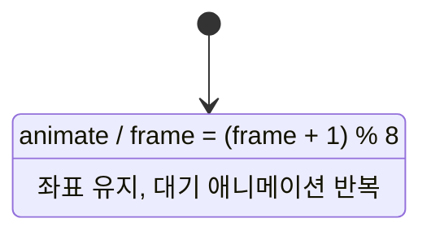

# Boy 상태 머신



`update()`는 `animate` 이벤트를 호출합니다. `dest=None`인 내부 전이이므로
IDLE을 나가거나 재진입하지 않고 `animate_idle()`만 실행합니다.
오른쪽은 스프라이트 시트의 y=300, 왼쪽은 y=200 행을 사용합니다.

실행 환경에서 의존성을 설치한 뒤 이 폴더에서 실행하세요.

```sh
python -m pip install -r requirements.txt
python main.py
```
